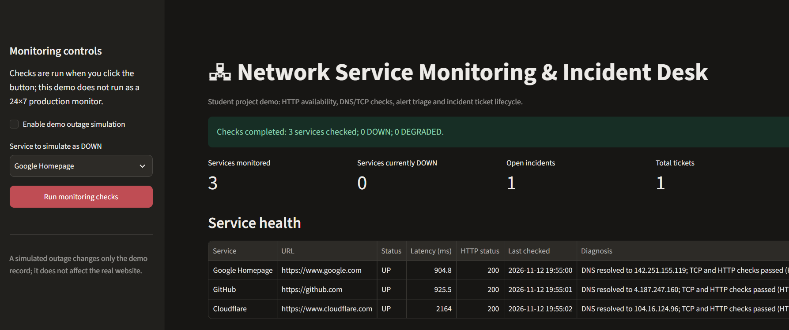
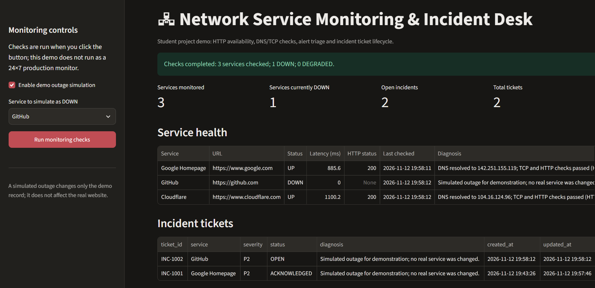
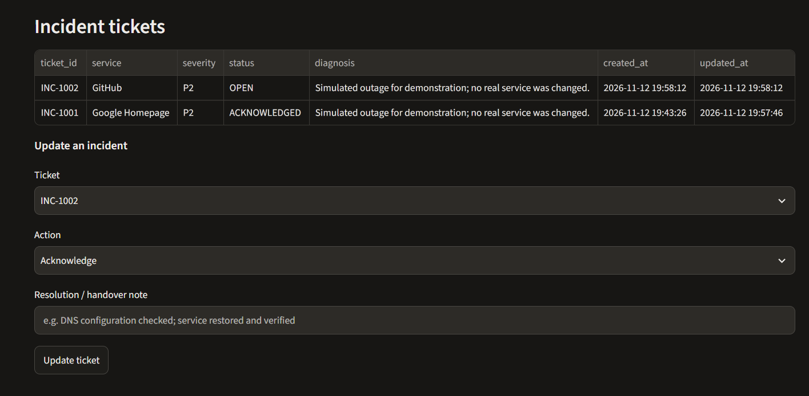
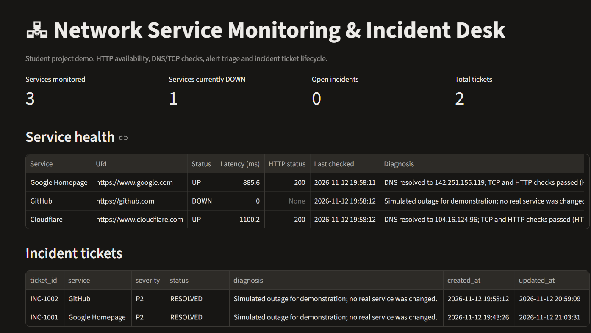
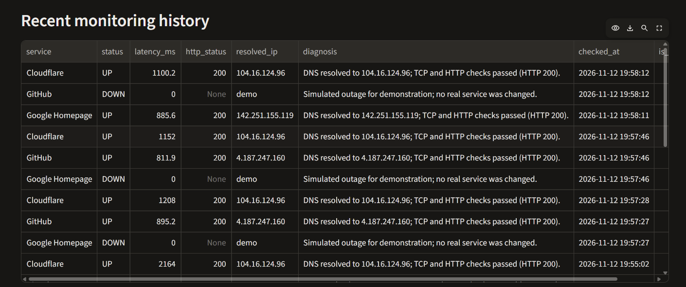

# Network Service Monitoring & Incident Desk

🚀 Live Demo: https://monitoringnetworkdashboard.streamlit.app/

A small educational NOC-style project that demonstrates service availability checks, DNS/TCP/HTTP triage, alert-to-ticket creation, severity classification, ticket acknowledgement/resolution, and CSV reporting.

## Tech stack

- Python
- Streamlit (local dashboard)
- `requests` + Python `socket` (HTTP, DNS and TCP checks)
- SQLite (persistent check history and incident tickets)
- pandas (tables and CSV export)

## Run locally (Windows PowerShell)

1. Install Python 3.10 or later.
2. Extract this folder and open PowerShell in the project folder.
3. Create a virtual environment:
   ```powershell
   py -m venv .venv
   .\.venv\Scripts\Activate.ps1
   ```
4. Install dependencies:
   ```powershell
   python -m pip install -r requirements.txt
   ```
5. Start the dashboard:
   ```powershell
   streamlit run app.py
   ```
6. In the browser, click **Run monitoring checks**. Try **Enable demo outage simulation**, choose one service and run checks again. This creates a simulated incident ticket without changing any real website.
7. Acknowledge the ticket, then resolve it with a short note. Try the CSV export.

## What it demonstrates

- HTTP availability and response-time monitoring for a small list of services.
- DNS resolution and TCP connection checks before an HTTP request.
- Basic triage diagnosis from DNS, TCP, HTTP status and latency observations.
- Incident ticket generation with P1/P2/P3 severity, timestamps and status tracking.
- A simple incident lifecycle: OPEN -> ACKNOWLEDGED -> RESOLVED.
- Monitoring history and CSV export for handover/reporting.

## USP

- Live HTTP health checks on multiple services
- Automatic incident ticket creation on failure
- Severity classification
- Full incident lifecycle (Open → Acknowledged → Resolved)
- Basic diagnosis messages
- Monitoring history + ability to export incident records
- Includes a controlled demo outage mode so the complete failure-to-resolution flow can be demonstrated reliably during interviews or demos.
- Focuses on the operational process used in Network Operations / Incident Management roles rather than just displaying website status.

## Screenshots

### 1. Normal Dashboard


### 2. Service Down + Ticket Created


### 3. Ticket Created


### 4. Incident Resolved


### 5. Monitoring History (optional)


## Important limitations

- This is a local, manually triggered prototype, not an always-on production monitoring system.
- P1/P2/P3 severity rules are simplified demo rules, not an employer's official severity matrix.
- The outage simulation creates a local demo event; it does not take down a real service.
- Only the configured public HTTP endpoints are monitored. It does not configure physical routers/switches or replace enterprise NMS tools.
